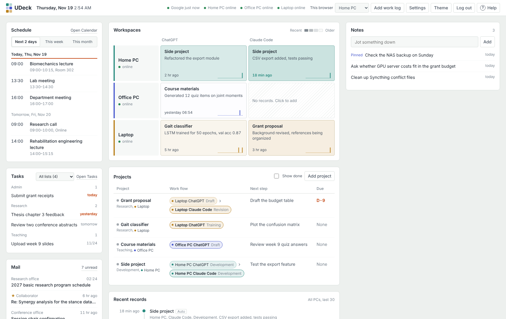

# UDeck

**여러 PC와 여러 AI 도구에 흩어진 작업을 한 화면에 모으는 작업 데스크 보드.** 구글 캘린더·할 일·메일과 함께, 각 PC에서 어떤 AI 도구로 어떤 프로젝트를 마지막으로 했는지 보여 준다. 어느 브라우저에서든 열어 하던 작업을 바로 이어 간다.

[English](README.md) · 한국어

## 주요 기능

- **작업공간 매트릭스**: 행은 PC, 열은 데스크톱 도구다. 칸마다 최근 작업이 표시되고, 최근일수록 색이 진하며 7일 활동 막대가 붙는다.
- **프로젝트와 작업 흐름**: 작업 폴더로 기록을 프로젝트에 자동 분류한다. "노트북 ChatGPT(초안) → 노트북 Claude Code(수정)" 같은 흐름과 다음 할 일, 마감을 보여 준다.
- **자동 기록**: Claude Code `Stop` hook이 응답마다 기록하고, Windows 작업 스케줄러가 15분마다 Codex 세션과 `HANDOFF.md` 변경을 보낸다.
- **HANDOFF.md**: 프로젝트 폴더의 인수인계 메모. 바뀌면 프로젝트의 다음 할 일이 갱신된다.
- **구글 캘린더·Tasks·Gmail**: Apps Script가 10분마다 일정(오늘·내일, 이번 주, 이번 달), 목록별 할 일, 읽지 않았거나 별표한 메일 제목을 보낸다. 계정을 나눠 보낼 수 있다.
- **메모**, **한국어·영어 화면**, **라이트·다크 테마**, 휴대폰 화면 지원.
- PHP와 SQLite 파일 하나로 동작하며 일반 공유 호스팅에서 돌아간다.

## 빠른 시작

1. `tools/server_check.php`를 웹 루트에 올려 `pdo_sqlite`와 SQLite 쓰기를 확인한 뒤 지운다.
2. `udeck` 폴더는 웹 루트 안에, `udeck_private` 폴더는 **웹 루트와 같은 위치**에 올린다. `.htaccess` 두 개를 빠뜨리지 않는다.
3. `udeck_private/config.sample.php`를 `config.php`로 복사하고 `setup_key`를 임의의 긴 값으로 바꾼다. `language`는 `ko` 또는 `en`.
4. `https://내도메인/udeck/`에 접속해 설치 키를 입력하고 비밀번호를 정한다.
5. 설정 → 연결 키에서 "구글 연동" 키를 만들고 `gas/UDeck_Sync.gs`를 Apps Script에 넣는다.
6. PC마다 "PC 작업 기록" 키를 만들어 복사한 뒤 `agent/install.cmd`를 더블클릭한다.

자세한 사용법은 UDeck 화면 오른쪽 위의 **도움말**에 한국어로 정리되어 있다. 설치 문서: [docs/INSTALL.md](docs/INSTALL.md) (영문).

## 알려진 제한 (1.0)

- 모든 시각은 한국 표준시(UTC+9)로 저장·표시한다.
- 설치 하나에 사용자 한 명.
- ChatGPT 앱의 일반 대화는 OpenAI 서버에만 있어 자동 기록할 수 없다. HANDOFF.md나 직접 입력으로 남긴다.
- 자동 실행 등록은 Windows만 지원한다.

## 라이선스

[MIT](LICENSE) © 2026 BS Biotec
