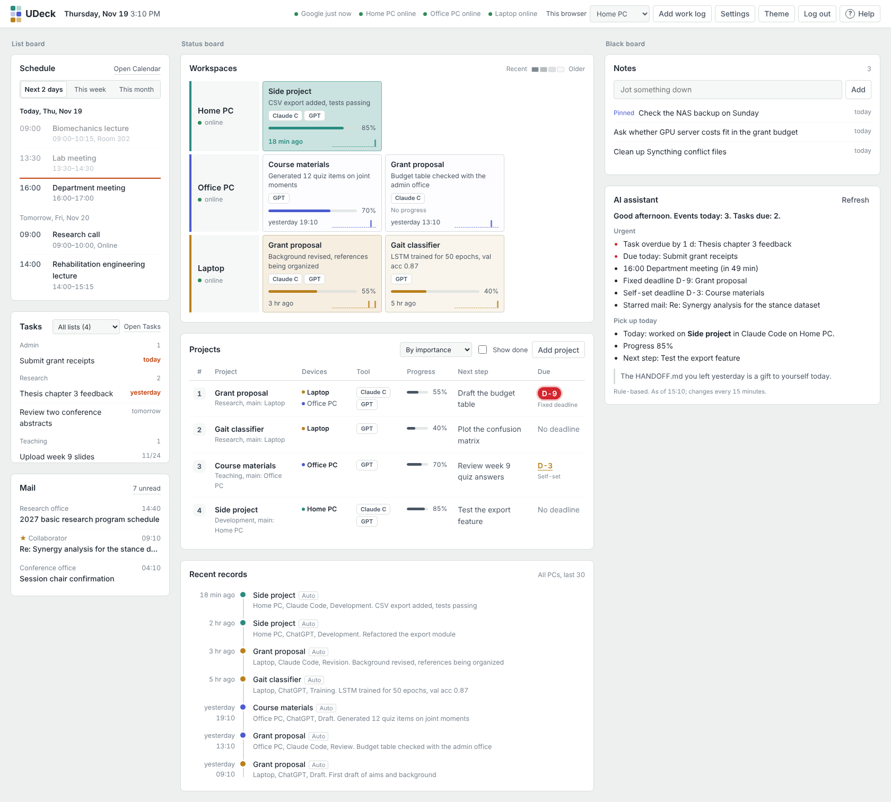
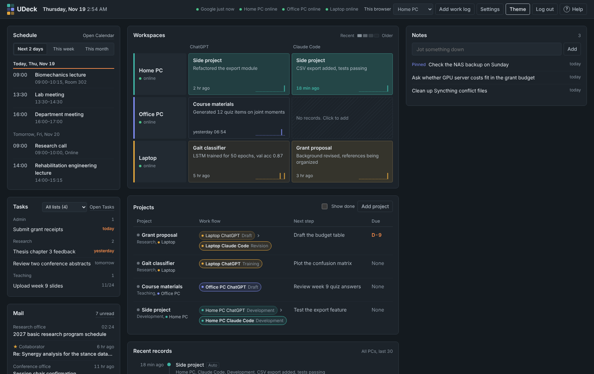

# UDeck

**One desk for work spread across several PCs and AI tools.** UDeck is a self-hosted web board that puts your Google Calendar, Google Tasks and Gmail next to a live view of what you last did on each PC, in each AI tool, for each project. Open it from any browser, see where you left off, and continue.

English · [한국어](README.ko.md)



## Why UDeck

If you work on a home PC, an office PC and a laptop, each with desktop AI apps such as Claude Code or the ChatGPT app, your work history ends up scattered: web chats sync, but desktop apps keep their sessions locally. UDeck collects a short record of each session (where, which tool, which folder, last request) and shows it as a matrix of **PCs × tools**, so you can tell at a glance what was happening where.

## Features

- **Three boards.** List board (schedule, tasks, mail), Status board (workspaces, projects, recent records) and Black board (notes, AI assistant). On phones, tabs switch between them.
- **Workspaces by project.** Rows are PCs (or people). Each row shows a box for every project worked on there, with the latest work, the tools used, progress and a 7-day activity strip, colored by recency like an activation heat map.
- **Projects.** Records are grouped by project automatically from the work folder. Each project shows the PCs and tools used, progress, next step and deadline (none, self-set or fixed; fixed deadlines show in red). Sort by importance (drag to reorder), deadline or date added.
- **Automatic logging.** A Claude Code `Stop` hook records every reply. A small agent, run every 15 minutes by Windows Task Scheduler, records Codex sessions and `HANDOFF.md` changes. Nothing runs in the background between runs.
- **HANDOFF.md.** A handoff note in each project folder. When it changes, UDeck updates the project's next step, so moving between PCs or tools keeps its context.
- **Google Calendar, Tasks and Gmail.** A Google Apps Script sends events (next 2 days, this week, this month), open tasks grouped by list, and unread or starred mail subjects every 10 minutes. Different Google accounts can each send their own part.
- **Notes.** Quick notes with pinning, editing and completion.
- **AI assistant (rule-based).** Urgent items, what to pick up today based on your most recent project work, and a proverb or short line. No external AI API, so no cost.
- **English and Korean.** Switch the interface language in Settings. The built-in help is available in both.
- **Light and dark themes**, responsive down to phones.
- **Small footprint.** Plain PHP and one SQLite file. No framework, no build step, no external services besides Google Apps Script.



## How it works

```
Google account ── Apps Script (every 10 min) ─────────────┐
                                                           ▼
PC ── Claude Code Stop hook (after each reply) ──▶  udeck/ingest.php  ──▶  udeck_private/data/udeck.sqlite
   └─ agent via Task Scheduler (every 15 min) ──▶        (connection key)
                                                           ▲
Browser ── udeck/ (login, board, settings, help) ─────────┘
```

Only short metadata is sent: PC, tool, session ID, work folder, the first 500 characters of the last request and the first 300 characters of the last reply. Source code, files, full conversations and mail bodies are never sent.

## Requirements

| Part | Requirement |
|---|---|
| Server | Apache with `.htaccess` (mod_rewrite), PHP 8.0 or later with `pdo_sqlite`, SQLite 3.26 or later, HTTPS recommended. Works on ordinary shared hosting. |
| PC agent | Windows 10/11 and Python 3.8 or later (no extra packages). The Claude Code hook itself also runs on macOS and Linux. |
| Google sync | A Google account with access to script.google.com |

## Quick start

1. **Check the server.** Upload `tools/server_check.php` to your web root, open it in a browser, confirm that `pdo_sqlite` and SQLite writing pass, then delete it.
2. **Upload two folders.** The private folder must sit **next to** your web root folder, not inside it:
   ```
   /home/you/
   ├─ public_html/            ← your web root (may be named www, htdocs, ...)
   │  └─ udeck/               ← upload the udeck folder here
   └─ udeck_private/          ← upload the udeck_private folder here
   ```
   Include both `.htaccess` files (FTP clients may hide dot files).
3. **Create the configuration.** Copy `udeck_private/config.sample.php` to `udeck_private/config.php` and set `setup_key` to a long random value. Optionally set `language` to `en` or `ko`.
4. **Set your password.** Open `https://your-domain.com/udeck/`, enter the setup key, and choose a password of 12 characters or more.
5. **Connect Google.** In UDeck, go to Settings → Connection keys and create a *Google sync* key. Then follow [Google sync](docs/GOOGLE_SYNC.md) to add the Apps Script in `gas/`.
6. **Install the PC agent.** Create a *PC work logging* key for each PC, copy it, and double-click `agent/install.cmd` on that PC. See [PC agent](docs/PC_AGENT.md).

Full instructions: [Installation](docs/INSTALL.md), [Google sync](docs/GOOGLE_SYNC.md) (including how to update the Apps Script) and [PC agent](docs/PC_AGENT.md). A complete Korean manual is in [docs/MANUAL.ko.md](docs/MANUAL.ko.md). The in-app **Help** page covers everyday use.

## Repository layout

| Path | Contents |
|---|---|
| `udeck/` | Public web files: pages, JSON APIs, CSS, JavaScript |
| `udeck_private/` | Libraries, schema, language file and configuration. Keep outside the web root. The `data/` and `sessions/` folders are created on first run. |
| `agent/` | PC agent: installer, Claude Code hook, scheduled agent |
| `gas/` | Google Apps Script for Calendar, Tasks and Gmail |
| `tools/` | Server environment check |
| `docs/` | Installation and integration guides |

## Security

- Single user, password protected. Five failed logins in 15 minutes lock login for 15 minutes.
- The password and all connection keys are stored only as hashes.
- The setup page requires the `setup_key` from `config.php`, so nobody else can claim a freshly uploaded installation.
- The database, configuration and sessions live outside the web root. `.htaccess` also blocks direct access to internal files.
- Optional IP allow list (`allowed_ips`), for example to restrict access to a Tailscale network.

## Known limitations (1.2)

- Times are stored and shown in Korea Standard Time (UTC+9).
- One user per installation.
- Regular ChatGPT app chats live only on OpenAI's servers and cannot be logged automatically; use `HANDOFF.md` or a manual record.
- Scheduled agent registration is Windows-only.

## Data and backup

All data is in one file, `udeck_private/data/udeck.sqlite`. Download it to back up. When updating, upload new code but do not overwrite `udeck_private/config.php`, `data/` or `sessions/`. Schema changes are applied automatically on the next page load.

## Changelog

See [CHANGELOG.md](CHANGELOG.md).

## License

[MIT](LICENSE) © 2026 BS Biotec
